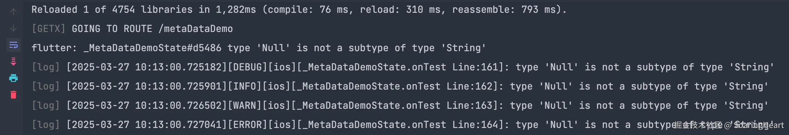
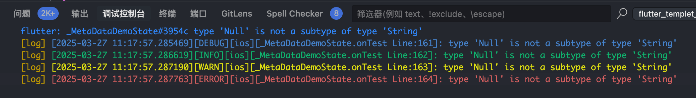

# DDLog

Flutter 最简单好用的日志工具 / The simplest and most handy Flutter logging tool.

Output format / 输出格式:

```text
[DateTime.now()][Type][System][Class.method file.dart:line]: ...
```

Flags / 开关:

```dart
DLog.enableLog = true;       // master switch / 总开关
DLog.onlyInDebug = true;     // skip release when true / 为 true 时 release 不打印
DLog.enableCallerInfo = true; // class/file/line / 是否解析调用点
DLog.enableColor = false;    // ANSI colors / 颜色
```

## Example / 示例

```dart
void onTest() {
  // DLog.d("AAA");
  try {
    var map = {};
    jsonDecode(map["a"]);
  } catch (e) {
    debugPrint("$this $e");//flutter: _MetaDataDemoState#d5486 type 'Null' is not a subtype of type 'String'
    DLog.d("$e");//flutter: [2025-03-27 10:13:00.725182][DEBUG][ios][_MetaDataDemoState.onTest main.dart:161]: type 'Null' is not a subtype of type 'String'
    DLog.i("$e");//flutter: [2025-03-27 10:13:00.725901][INFO][ios][_MetaDataDemoState.onTest main.dart:162]: type 'Null' is not a subtype of type 'String'
    DLog.w("$e");//flutter: [2025-03-27 10:13:00.726502][WARN][ios][_MetaDataDemoState.onTest main.dart:163]: type 'Null' is not a subtype of type 'String'
    DLog.e("$e");//flutter: [2025-03-27 10:13:00.727041][ERROR][ios][_MetaDataDemoState.onTest main.dart:164]: type 'Null' is not a subtype of type 'String'
  }
}
```

Disable ANSI color (Android Studio console) / 关闭颜色（Android Studio 不支持 ANSI）:

```dart
DLog.enableColor = false;
```



Enable color (VS Code) / 打开颜色（VS Code 支持）:

```dart
DLog.enableColor = true;
```



## Getting Started / 开始使用

This package lives at `packages/ddlog` in the monorepo.  
本包位于 monorepo 的 `packages/ddlog`。

External apps / 外部项目:

```yaml
dependencies:
  flutter:
    sdk: flutter
  ddlog: ^1.1.3
```

更新记录见 [CHANGELOG.md](CHANGELOG.md)。
